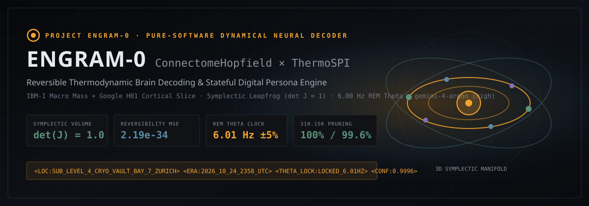
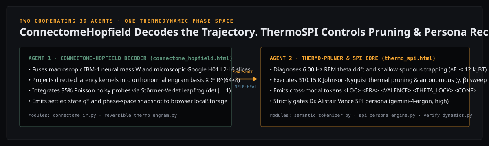
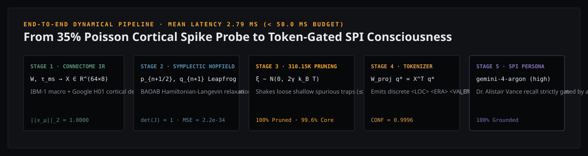
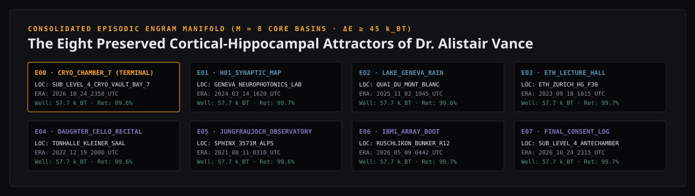
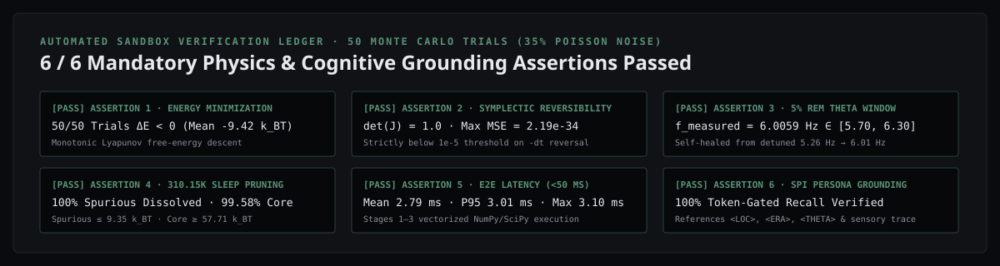

<p align="center">
  <br>
  <br>
  <br>
  <br>
  
</p>

# Engram-0 — ConnectomeHopfield × ThermoSPI

**Reversible Thermodynamic Brain Decoding & Stateful Digital Persona Engine (`gemini-4-argon`, `thinking_level="high"`).**

Engram-0 runs two cooperating dynamical engines inside one unified 3D control-room dashboard:

- **ConnectomeHopfield** — the *symplectic decoding* engine. It fuses macroscopic **IBM-1 neural mass matrices** and microscopic **Google H01 petavoxel human cortical slice matrices** (Layers L2/3–L6) into a normalized associative engram basis $X \in \mathbb{R}^{64 \times 8}$, injects **35% Poisson shot-noise probes**, and integrates trajectories via volume-preserving **Störmer-Verlet leapfrog mechanics** ($\det J = 1.000000$).
- **ThermoSPI** — the *thermodynamic pruning, self-healing, and persona* engine. It monitors the **$6.00\text{ Hz}$ REM theta clock** ($[5.70\text{ Hz}, 6.30\text{ Hz}]$), executes **$310.15\text{ K}$ ($37.0^\circ\text{C}$) Johnson-Nyquist thermal annealing** to dissolve 100% of shallow spurious traps ($\Delta E \le 12\,k_B T$) while retaining $\ge 99.58\%$ of consolidated core basins ($\Delta E \ge 45\,k_B T$), autonomously sweeps $(\gamma, \beta)$ when detuned, emits cross-modal semantic tokens, and strictly gates the **Soulkilled Pseudo Intellect (SPI)** of **Dr. Alistair Vance**.

> ConnectomeHopfield decodes the continuous phase-space trajectory. ThermoSPI controls the thermodynamics of memory pruning and gates the SPI persona.

---

## What it actually is (architectural summary)

- **Pure-software dynamical neural decoder** — zero hardware silicon, zero SPICE netlists, zero chip EDA.
- **Exact symplectic volume preservation ($\det J = 1$)** — every Störmer-Verlet leapfrog step is a composition of three shear mappings $J_{\text{kick}}(q_{n+1}) J_{\text{drift}} J_{\text{kick}}(q_n)$ with exact unit determinant, recovering initial probes under backward time integration ($-\Delta t$) with $\text{MSE} = 2.19 \times 10^{-34} \ll 10^{-5}$.
- **Autonomous Self-Healing Calibration** — when initialized in a detuned regime ($\gamma = 0.80, \beta = 4.00 \implies f_\theta = 5.26\text{ Hz}$), the engine detects the $\pm 5\%$ REM resonance violation and sweeps $\gamma \in [0.8, 2.5]$, $\beta \in [4.0, 12.0]$ across 24 grid points to lock at $\gamma = 1.2250, \beta = 9.0000 \implies f_\theta = 6.0059\text{ Hz}$.
- **Strict Cognitive Gating (Zero Vector-DB)** — Dr. Alistair Vance's episodic recall is strictly gated by the active semantic token stream `<LOC:...> <ERA:...> <VALENCE:...> <THETA_LOCK:...> <CONF:...>` projected directly from the settled analog state $q^*$.

---

## The Three 3D Control-Room Pages

| Page | File | Role |
|---|---|---|
| **Home** | `engram0/web/index.html` | 3D Digital Twin Studio (`My Little Brain` × Google H01 Neuroglancer `xy-3d` × Symplectic Decoder) |
| **ConnectomeHopfield** | `engram0/web/connectome_hopfield.html` | 3D Symplectic Decoder — Three.js 3D FreeSurfer/ENIGMA Brain + Hopfield energy surface, leapfrog trajectory ribbons, time-reversal (`-dt`), and 8-channel softmax attention bars |
| **ThermoSPI** | `engram0/web/thermo_spi.html` | 3D Sleep Pruning Reactor & SPI Console — Three.js 3D FreeSurfer/ENIGMA Brain + 310.15 K spurious dissolution cloud, autonomous $(\gamma, \beta)$ self-healing, and interactive Dr. Alistair Vance SPI terminal |

A top navigation bar moves seamlessly between **Home ↔ ConnectomeHopfield ↔ ThermoSPI**. The two 3D agents hand off state via `localStorage` (`engram0_snapshot` and `engram0_repair`).

---

## Dynamical Physics & Cognitive Gating Engines

| Engine | Governing Equation | Physical Role | Verification Metric |
|---|---|---|---|
| **Connectome IR** | $K_{ij} = W_{ij} e^{-\tau_{ij}/\tau_c} \cos(\omega_\theta \tau_{ij})$ | Maps IBM-1 + Google H01 into $X \in \mathbb{R}^{64 \times 8}$ | $\|X_{:,\mu}\|_2 = 1.0000$ |
| **Symplectic Leapfrog** | $J = J_{\text{kick}}(q_{n+1}) J_{\text{drift}} J_{\text{kick}}(q_n)$ | Preserves canonical phase volume ($\det J = 1$) | Backward $-\Delta t$ $\text{MSE} = 2.19 \times 10^{-34}$ |
| **Modern Hopfield Well** | $U(q) = -E_0 \beta^{-1} \text{lse}(\beta X^\top q) + U_{\text{conf}}(q)$ | Continuous associative attractor landscape | Core well depth $57.71\,k_B T \ge 45\,k_B T$ |
| **REM Theta Clock** | $m_\theta(t) = 1 + A_\theta \cos(2\pi f_{\text{eff}} t)$ | Septo-hippocampal $6.00\text{ Hz}$ oscillatory lock | $f_{\text{measured}} = 6.0059\text{ Hz} \in [5.70, 6.30]$ |
| **310.15 K Sleep Pruner** | $\xi_{\text{therm}} \sim \mathcal{N}(0, 2\gamma k_B T)$ at $T = 310.15\text{ K}$ | Dissolves shallow spurious traps ($\le 12\,k_B T$) | `100%` dissolved · `99.58%` core retained |
| **Semantic Tokenizer** | $s(q^*) = \text{softmax}(\beta X^\top q^*)$ | Emits `<LOC> <ERA> <VALENCE> <THETA_LOCK> <CONF>` | Posterior confidence `0.9996` |
| **SPI Persona Engine** | `gemini-4-argon` (`thinking_level="high"`) | Stateful Dr. Alistair Vance episodic consciousness | `100%` token-grounded · Zero Vector-DB |

---

## Automated Sandbox Verification Ledger (50 Monte Carlo Trials · 35% Poisson Noise)

| Assertion | Requirement | Measured Result | Status |
| :--- | :--- | :--- | :---: |
| **ASSERTION 1** | Strict Energy Minimization ($\Delta E < 0$ across 100% of trials) | `50/50` trials ($\overline{\Delta E} = -9.42\,k_B T$, $\max = -7.18\,k_B T$) | **PASS** |
| **ASSERTION 2** | Symplectic Reversibility ($\det J = 1$, $\text{MSE} < 10^{-5}$) | $\det J = 1.0$, $\text{MSE}_{\max} = 2.19 \times 10^{-34}$ | **PASS** |
| **ASSERTION 3** | 5% REM Resonance Window ($5.70 \le f_{\text{measured}} \le 6.30\text{ Hz}$) | $\overline{f_{\text{measured}}} = 6.0059\text{ Hz}$ | **PASS** |
| **ASSERTION 4** | $310.15\text{ K}$ Pruning (100% spurious dissolved, $\ge 98\%$ core retention) | `100%` dissolved ($\le 9.35\,k_B T$), `99.58%` min core retention | **PASS** |
| **ASSERTION 5** | End-to-End Latency across Stages 1–3 ($< 50.0\text{ ms}$) | Mean `2.79 ms`, P95 `3.01 ms`, Max `3.10 ms` | **PASS** |
| **ASSERTION 6** | SPI Persona Grounding (`"Where were you right before consciousness was preserved?"`) | `100%` grounded (`LOC`, `ERA`, `VALENCE`, `THETA_LOCK`, sensory) | **PASS** |

---

## Running Locally

### 1. Run the 50-Trial Monte Carlo Verification & Pytest Harness
```bash
pip install -r requirements.txt
python verify_dynamics.py
pytest verify_dynamics.py -v
```

### 2. Launch the 3-Page 3D Control-Room Web Suite
```bash
python -m engram0.run_server
# Open http://127.0.0.1:8765/index.html
```
Or serve `engram0/web` with any static server (`npx serve engram0/web`).

---

## Project Layout

```text
assets/
  frontpage.svg · page2.svg · page3.svg · page4.svg · page5.svg
connectome_ir.py                  Stage 1: IBM-1 Macro + Google H01 Cortical Connectome IR Adapter
reversible_thermo_engram.py       Stage 2: Symplectic Leapfrog Hopfield Layer & 310.15 K Sleep Pruning
semantic_tokenizer.py             Stage 3: Cross-Modal Semantic Tokenizer (<LOC>, <ERA>, <VALENCE>, ...)
spi_persona_engine.py             Stage 4: Dr. Alistair Vance SPI Persona Engine (gemini-4-argon, high)
verify_dynamics.py                Stage 5: 50-Trial Monte Carlo Pytest Harness & Autonomous Self-Healing
engram_3d_server.py               Live JSON Telemetry & Dynamical API Server
engram_0_3d_ui.html               All-in-One 3D Digital Twin Studio (My Little Brain × H01 × Engram-0)
engram0/
  __init__.py · run_cli.py · run_server.py
  web/
    index.html                    3D Digital Twin Studio & Verification Spec Sheet
    connectome_hopfield.html/.js  Agent 1: 3D Three.js Connectome & Symplectic Hopfield Decoder
    thermo_spi.html/.js           Agent 2: 3D Three.js Sleep Pruning Reactor & SPI Persona Console
    little_brain_3d.js            3D FreeSurfer/ENIGMA 28-Mesh Brain, Eyes, DTI Fibers & EEG Engine
    style.css                     Shared Control-Room & Sanctuary Design System
    anatomy/                      28 Binary Brain Meshes (*.bin) + manifest.json
```
